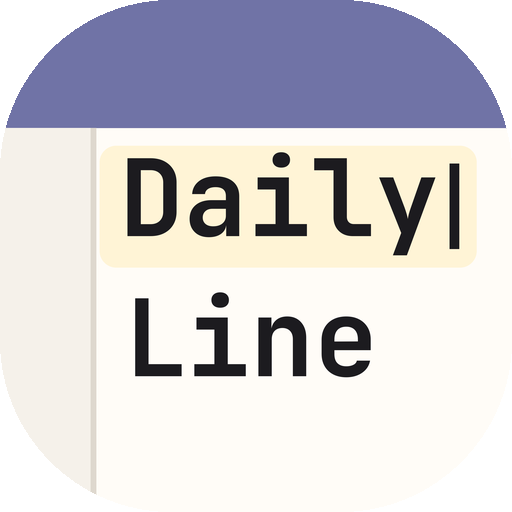
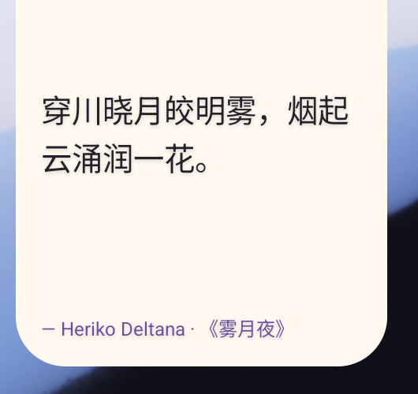
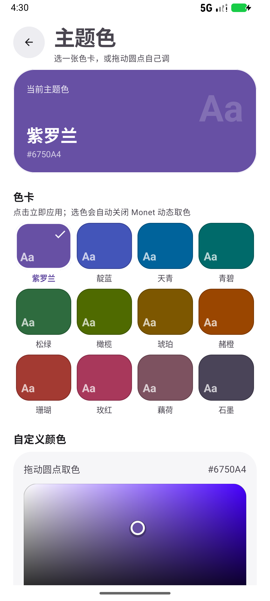
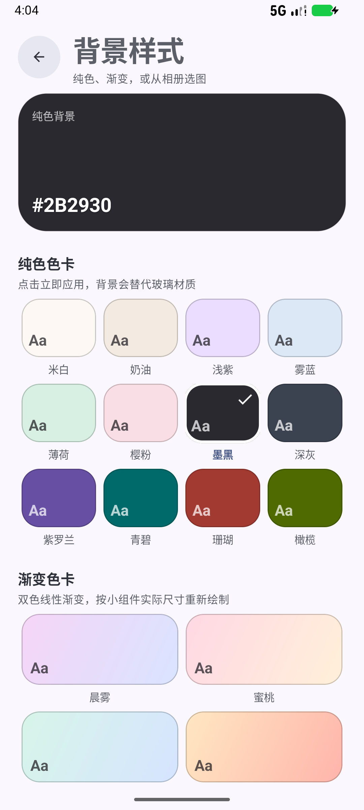
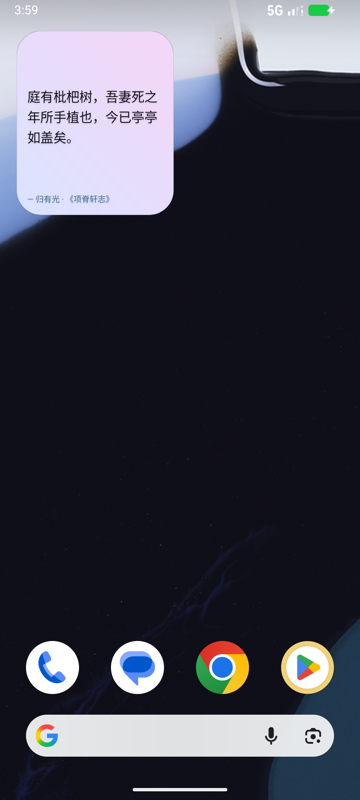

  

# 每日一言 / DailyLine

应用名随系统语言变化：简体中文（`values-zh-rCN`）下显示 **每日一言**，其他语言回退到 `DailyLine`。其余界面文案目前仍是中文硬编码。

一个 Java Android 主屏幕哲学句子小组件。项目包含 100+ 条来自外国哲学作品的条目，并区分 `原文` 与 `译写 / 意译`。意译条目不会被伪装成逐字引文；部分中文原文条目保留常见英文译文，便于核对作品出处。

版本：分类禁用与 12 分类并入管理那一版已归档为 **3.10**，玻璃材质为 **3.11**，回桌面换句为 **3.12**；3.13 把自定义布局升级为可重叠的自由排版；3.14 让毛玻璃真的模糊壁纸；4.0.0 新增「自定义背景」（相册选图 / GIF 首帧，可选高斯模糊与强度）、玻璃高级设置和系统相册选择器；4.0.1 换用 JetBrains Mono 字标的自适应图标，并把玻璃材质收敛为单套透镜参数；4.1.1 适配各厂商 2×2 锁定桌面，新增主题色二级页（色卡 + 带触摸点的取色器）和背景样式二级页（纯色 / 渐变 / 图片）；4.2.0 新增「保存组件」，可保存最多 10 套主题 / 背景 / 布局 / 玻璃参数；4.2.1 自定义布局里的图片拖动缩放改为等比；**4.2.2** 小组件配图与自定义图片框改为完整显示（fitCenter），不再裁掉图片边缘。

### 玻璃为什么「没生效」，3.14 怎么修的

小组件拿不到身后的像素：`RemoteViews` 没有 `RenderEffect` / `RuntimeShader`，launcher 也不会把壁纸交出来。3.13 把玻璃简化成「透明底 + 一层染色」之后，两种材质的差别只剩 alpha——桌面上看就是一块白纱，正是「没生效」。

3.14 按 FolkPatch 的做法把「背景」自己造出来：

- **毛玻璃**：`WallpaperManager` 读真实壁纸 → 按小组件比例中心裁剪 → 缩到 760px → 两遍盒式模糊（≈高斯）→ 逐像素透镜（SDF 折射 / 色散 / 提饱和 / 只提暗部的自适应薄雾 / rim line / 定向高光）→ 输出一张真正模糊过的玻璃位图。
- **液态玻璃**：半透明透镜——读到壁纸时只做轻模糊（保留壁纸结构），再叠长距离边缘折射、色散和高光，透明度约 68%，桌面真实壁纸仍从下面透上来参与叠色；读不到壁纸时退回纯透明光学层（不模糊）。
- Android 14 起只有「所有文件访问」(`MANAGE_EXTERNAL_STORAGE`) 拿得到壁纸像素，所以「个性」页多了一行状态和一个「去授权读取壁纸」按钮；授权后预览与桌面立刻重画。不授权时毛玻璃退回壁纸取色（不模糊），预览里会直接写明。
- 预览用的就是桌面上那张位图：底下铺真实壁纸，上面叠同一个 `GlassRenderer` 的输出，所见即桌面。
- **实时玻璃页**（「个性」→「打开实时玻璃页」）：换成 GPU 每帧算的版本——`RuntimeShader`（AGSL）+ `RenderEffect.createChainEffect(着色器, 模糊)`，着色器里用圆角矩形 SDF 做折射、RGB 色散、提饱和/对比、混 tint、叠边缘高光；液态与毛玻璃只是模糊半径不同。做法与参数直接取自 FolkPatch 用的 `FletchMcKee/liquid`（Apache-2.0，见 NOTICE.md）。

### 自定义布局：重叠与任意角度旋转（3.13）

- 文字框与最多 4 个图片框不再互斥：可以任意重叠，图片按添加顺序盖在文字上面
- 选中框后拖**右上角圆点**旋转，任意角度、无吸附；拖右下角圆点改大小；「旋转」按钮每次微调 +1°，长按归零
- 文字框和图片都能旋转，图片仍支持删除、水平 / 垂直镜像
- 文字框底色改为透明，只保留 1dp 描边，和图片 / 玻璃叠在一起时透出下层
- 旋转角度以浮点数保存（场景数据版本 2）；旧布局里的 0/90/180/270 会自动迁移，不会横竖颠倒

### 回桌面自动换一句（3.12）

Android 没有「进入桌面」的广播，所以用一个每 0.2 秒一次的轻量 shell 脚本盯住焦点窗口，切回桌面时发一次换句广播。两条后端：

| 后端 | 前置 | 脚本位置 |
| --- | --- | --- |
| Root（优先） | Magisk/APatch 授予本应用 root | 应用私有目录 |
| Shizuku | Shizuku 正在运行并已授权（进 App 会自动弹授权框） | /data/local/tmp |

- 进 App 时自动向 root 管理器和 Shizuku 各要一次权限，状态行显示 Root：已授权 · Shizuku：未授权 · 监听中（root）
- 不占应用进程、不起前台服务、不弹通知；BootReceiver 开机后自动把脚本拉回来
- Shizuku 集成需要 
ikka.shizuku.ShizukuProvider 且**不能**加 moe.shizuku.manager.permission.API_V23（shizuku_server 以 shell 身份来取 binder，加了会 Permission Denial）

## 功能

- 主屏幕 App Widget，默认 2×2，`resizeMode="horizontal|vertical"`，支持横向和纵向自由调整。
- **2×2 自适应排版**：各厂商桌面默认把组件锁在 2×2，宽度只有约 110–180dp。这个尺寸下会自动切换紧凑版（见下图）：隐藏右侧配图、文字占满整宽、作者行压成一行、字号和行距按实际像素重算；放大到 3×3 以上才恢复配图与完整元信息。
- 显示句子、作者、作品出处及条目类型。
- 点按小组件换一句；设置页可关闭译写 / 意译条目，并让全部小组件刷新。随机一言完全使用内置 Hitokoto 语料，不再联网请求。
- 添加一言只需填写句子：作者与出处均为选填，留空时小组件与管理页会自动省略这一段。
- 一言管理支持给条目配图（含 GIF）：图片显示在小组件右侧、文字在左侧，使用 fitCenter 完整显示而不是 centerCrop 裁切；2×2 紧凑版会先让文字可读，配图暂不显示，放大后自动恢复。
- GIF 会预拆成逐帧 PNG（间隔固定 200 ms、最多 12 帧、单帧最长边 160 px，拆帧时会跳过连续重复帧），小组件用 `AdapterViewFlipper` + `RemoteViewsService` 在桌面本地翻页，不需要应用进程反复刷新；首帧同时铺在静态 `ImageView` 上，遇到不支持集合控件的桌面也还能显示。管理页编辑时可看原始动画。
- 自定义布局（开关 + 编辑器）：文字框与最多 4 个图片框都可拖动，可以任意重叠；文字和图片都能拖右上角圆点按任意角度旋转，拖右下角改大小；**图片框拖动缩放时保持宽高比**（取横 / 纵拖动更明显的一轴作为统一倍率），文字框仍可自由调整；图片支持删除、水平/垂直镜像；文字框可开启为透明描边框；小组件尺寸可在编辑器里用「宽 +/− / 高 +/−」调整，画布按同样宽高比预览。坐标以 0–1 分数保存，小组件按实际尺寸用 padding 还原。桌面端收不到拖拽事件，所以拖拽只发生在应用内画布上。
- 配图经系统文件选择器（SAF）选取后立刻复制到应用私有目录 `files/quote_images/`，不占相册授权、也不依赖可撤销的 `content://` 权限；单张上限 16 MB。
- **自定义主题色二级页**：从「个性」Tab 的「自定义主题色」进入，12 张 Material 3 Expressive 色卡 + 带触摸点和色相游标的取色器；点选立即刷新桌面，会自动关闭 Monet，深色模式只校正明度、不覆盖用户选的颜色。选择后 App 内的按钮、开关、滑块、底部导航和选中态也会跟随换色，返回设置页自动重建。
- **随机一言**：不再提供联网开关；Hitokoto 只作为本地 assets 语料参与轮换，可在设置页整体关闭「显示 Hitokoto 语料」。
- **自定义背景二级页**（「个性」→ 自定义背景 →「选择纯色 / 其他」，与玻璃材质互斥）：纯色色卡、8 种双色渐变、自定义取色器，以及相册图片 / GIF。纯色和渐变按小组件实际尺寸重新绘制圆角卡片，文字自动按背景亮度切换黑白；图片仍支持高斯模糊，模糊程度 0–100% 实时预览。选完立刻复制进应用私有目录，不依赖 `content://` 授权。
- 玻璃高级设置（「个性」→「玻璃高级设置」）：对齐方式（不对齐 / 手动 X·Y 偏移 / 无障碍自动读取小组件位置）、以及实验性的 Vector/LSPosed 桌面注入开关。
- 玻璃材质（「个性」Tab）：4.0.1 起只保留一套毛玻璃透镜参数，不再需要在毛玻璃 / 液态玻璃之间二选一。
  - 渲染管线：真实壁纸 → 中心裁剪 → 缩样 → 盒式模糊；再逐像素走透镜管线（SDF 求边缘与法线 → 沿法线向内采样做折射 → 边缘 RGB 色散 → 提饱和 → 只提暗部的自适应薄雾 → rim line / 定向高光 / 背光侧内阴影），SDF 覆盖率当 alpha。灯下看起来是一块透镜，而不是一层糊。
  - 「雾面程度 / 玻璃浓度 / 高光 / 圆角 / 浅深色调」都能在页面里实时预览；预览底图就是 App 读到的真实壁纸，玻璃位图和桌面上用的是同一份渲染结果。玻璃要读壁纸，所以同一张卡片里有「壁纸读取」状态和授权入口。
- 「实时玻璃页」仍然用 GPU 上的 RuntimeShader 每帧计算折射、色散和高光，能直接看到玻璃边缘随背景变化。
- 「个性」Tab = 玻璃材质 + 桌面布局 + 字号 + 主题色；「设置」Tab 仍是 XML 导入、GitHub Release 更新检查与下载安装、说明书。更新检查优先走 `api.github.com`，被 DNS 拦掉时退回 `github.com/…/releases.atom`。
- XML 导入格式：根节点随意，条目用 `<quote>` 或 `<item>`，属性 `text/author/work/category` 或同名子标签均可，只有 `text` 必填，重复条目跳过；设置页「选择 XML 文件」下方有「查看格式和示例」弹窗，示例可直接选中复制。
- Android 6.0+（minSdk 24），Java 实现。

## 玻璃是怎么算出来的

参考社区里把 iOS 26 Liquid Glass 在 Android 上复刻出来的实现（[react-native-liquid-glassmorphism](https://github.com/himanshu-lal4/react-native-liquid-glassmorphism)、[作者拆解](https://github.com/himanshu-lal4/react-native-liquid-glassmorphism/blob/218a47281e1f01e91a024fef83d62f48c3f5f9fc/growth/blog-android-agsl-deep-dive.md)）：它不是模糊面板，而是一块**透镜**——用圆角矩形的 SDF 取到边距离与法线，在边缘把采样坐标沿法线向内推，背景因此被「折」进来；再叠色散、vibrancy、自适应薄雾、干净的 rim line 与定向高光。那边用 `RuntimeShader`（AGSL，API 33+）在 GPU 上跑，这里因为结果要塞进 `RemoteViews`，用同一套数学在 CPU 上逐像素算成位图（工作分辨率上限 860px，单次渲染几十毫秒，在后台线程做）。

| 限制 | 现实 | 这里的取舍 |
| --- | --- | --- |
| 小组件能不能对桌面做实时 backdrop blur | 不能。`RemoteViews` 没有 RenderEffect / RuntimeShader，launcher 也不会把身后的像素交出来 | 毛玻璃用 `MANAGE_EXTERNAL_STORAGE` 读到壁纸后自己算；液态玻璃则让壁纸直接透出 |
| 毛玻璃的壁纸和桌面上的壁纸对不齐 | 小组件无法知道自己摆在壁纸哪一格 | 按中心裁剪；透镜 + 模糊会掩盖大部分差异，但放大看边界仍可能有色差 |
| 小组件能不能做「实时」玻璃 | 不能：渲染一次是一张位图，`RemoteViews` 也没有 RenderEffect / RuntimeShader | 每次刷新按当前壁纸重算；要逐帧实时只能进 App 的「实时玻璃页」 |
| App 内能不能做实时玻璃 | 能：`RenderEffect` + `RuntimeShader`（API 33+）每帧跑在 GPU 上 | 「实时玻璃页」把背景画进自己这一层，着色器直接采样，边缘折射跟着背景动 |

隐私：`MANAGE_EXTERNAL_STORAGE` 只被 `WallpaperSource` 用来读一张壁纸位图（60 秒缓存，壁纸换了才会重读），不遍历任何文件；不授权时毛玻璃退回壁纸取色，其他功能不受影响。

## 构建

在安装 Android Studio、Android SDK 35 和 JDK 17+ 的机器上打开本目录，等待 Gradle 同步，然后运行 `:app:assembleDebug`（或 `:app:assembleRelease`）。APK 位于 `app/build/outputs/apk/debug/app-debug.apk` / `app/build/outputs/apk/release/app-release.apk`。Release 目前沿用 debug 签名，方便直接覆盖安装自测。

## 在桌面添加小组件

应用内「将小组件添加到桌面」走 `AppWidgetManager.requestPinAppWidget()`，并用 `getAppWidgetIds()` 的数量变化校验是否真的添加成功（该 API 在失败时同样返回 `true`）。失败后按品牌兜底：

| 系统 | 实测行为 | 处理 |
| --- | --- | --- |
| AOSP / 三星 / ColorOS | 弹确认框，确认后添加 | 官方接口 |
| HyperOS / MIUI | 不弹框直接加；缺「桌面快捷方式」权限时静默失败 | 引导开启权限（直达权限编辑器） |
| HarmonyOS / EMUI | 弹确认框，但永不回调 PendingIntent | 数量校验 + 新建一页提示 |
| OriginOS / iQOO | 官方接口无效（需接入原子组件 SDK 并上架） | 直接给手动添加指引 |

`WidgetPinHelper.java` 负责这套兼容逻辑；ColorOS 的 `ToggleBar_widget` 面板入口仅作为兜底，且必须先 `resolveActivity` 确认存在。

## 2×2 锁定桌面的适配

  

HyperOS、HarmonyOS、ColorOS、OriginOS 等桌面默认把小组件放在 2×2 格子里，部分机型还不允许拖动改大小。原布局固定给右侧配图留 78dp、正文用 16sp，2×2 下正文只剩二三十 dp，会出现“一行两三个字、作者行挤成几行”的显示异常。现在的处理：

- `quote_widget_info.xml` 声明 `minWidth/minHeight=110dp`、`targetCellWidth/Height=2`，系统小组件选择器里默认就是 2×2，并带一份 2×2 的 `previewLayout` 静态预览。
- 更新时按实际尺寸分流：宽度 < 200dp 或高度 < 150dp 时用 `widget_quote_compact.xml`——不显示配图，文字占满整宽，作者/作品压成一行，提示语隐藏；更大的尺寸才用带配图的 `widget_quote.xml`。
- 字号不再直接套设置里的 16sp：按实际文字宽高、目标行数、系统 `fontScale` 反推，2×2 通常落在 11–15sp；`quote_text` 用 `maxLines` + `ellipsize` 截断，不会出现半行或文字叠在一起。
- 2×2 的元信息只保留作者和作品（`— 作者 · 《作品》`），类型/分类放不下就省略，避免出现 `Hito…` 这种截断尾巴。
- 自定义布局在 2×2 下同样按文字框的像素宽高缩字号，并按框高截断；新建自定义布局的默认画布改为 180×180，和 2×2 的实际比例接近。
- 尺寸读取兼容各 ROM：优先用 API 31 的 `OPTION_APPWIDGET_SIZES` 里与当前宽度成对的那一项（Pixel 上 2×2 实际是 179×210，而不是 MIN 报的 179×108），读不到再退回 MIN/MAX 与 160×150 安全值。

## 主题色与背景样式

  
  
  

- **主题色**：`ThemeColors` 统一管理色卡、取色器和桌面强调色。选择色卡会写入 `themeColor` 并关闭 `monet`，立即广播刷新小组件；`ColorPickerView` 增加了跟手触摸点、色相条游标，并在 `setColor()` 时正确回填初始 HSV。
- **App 界面换色**：`ThemedActivity` 在 `attachBaseContext` 里用 `ColorResourcesOverride` 注入由种子色生成的 M3 配色，再 force 应用 `ThemeOverlay.Yiyan.CustomColors`，覆盖 Material personalized colors 对 `colorPrimary` 和文字色的改写。这样设置页、管理页、编辑器、帮助页的按钮 / 开关 / 滑块 / 底栏都会跟随主题色，而不只是小组件作者行。
- **浅色模式**：App 背景使用纯白 `#FFFFFF`，卡片使用中性浅灰 `#F6F6F8`，不再使用米白 / 奶油色；深色模式保持原有暗色表面。
- **过渡动画**：底部 Tab 切换使用同方向平滑滑动；二级页面从右侧滑入、返回时向右滑出。
- **保存组件**：「个性」Tab 的「保存组件」可以把当前主题色、纯色/渐变/图片背景、自定义布局、玻璃参数和字号存成一套，最多 10 套；点击条目会二次确认「是否使用」，长按可「查看小组件视图」或「重命名」，右侧「删除」移除。查看视图会按自定义布局还原文字框、图片位置与旋转。保存的是外观预设，不改动语录和桌面上的小组件实例。
- **自定义布局自动读尺寸**：编辑器通过无障碍服务缓存的 `AppWidgetHostView` 矩形自动换算桌面实际宽高，画布比例直接对齐；没有无障碍数据时会显示「读取桌面组件大小」按钮并引导开启。提示行同时显示画布尺寸和桌面实测尺寸。
- **深色模式修复**：以前深色模式会把主题色强制覆盖成固定的 `#D0BCFF`，自定义色实际不生效。现在只在亮度过低时提高明度，色相保留；浅色模式下过亮的颜色会被压暗。
- **背景样式**：`CustomBackground` 新增 `solid` / `gradient` 两种类型。纯色和渐变不经过图片解码和模糊，而是用 `LinearGradient` 按小组件实际宽高、圆角和角度现画；渐变卡片、纯色色卡、自定义取色器都是即时应用。
- **可读性**：纯色/渐变背景会根据平均亮度选择深色或浅色正文，作者行使用用户主题色并按背景明度校正；图片背景继续沿用原来的玻璃色调逻辑。
- **设置入口**：「自定义主题色」和「选择纯色 / 其他」都是带色点/箭头的二级菜单行，设置页只保留当前样式摘要。

## 资料与准确性

`QuoteLibrary.java` 中 `原文` 是短句或常见英文译文，仍建议发布前按所选中文版本逐条校对页码；`译写 / 意译` 明确是思想转述。像“你必须成为你希望在世界中看到的改变”这类广泛流传但出处存在争议的句子已标为意译/争议性来源，避免当作可靠逐字引文。
